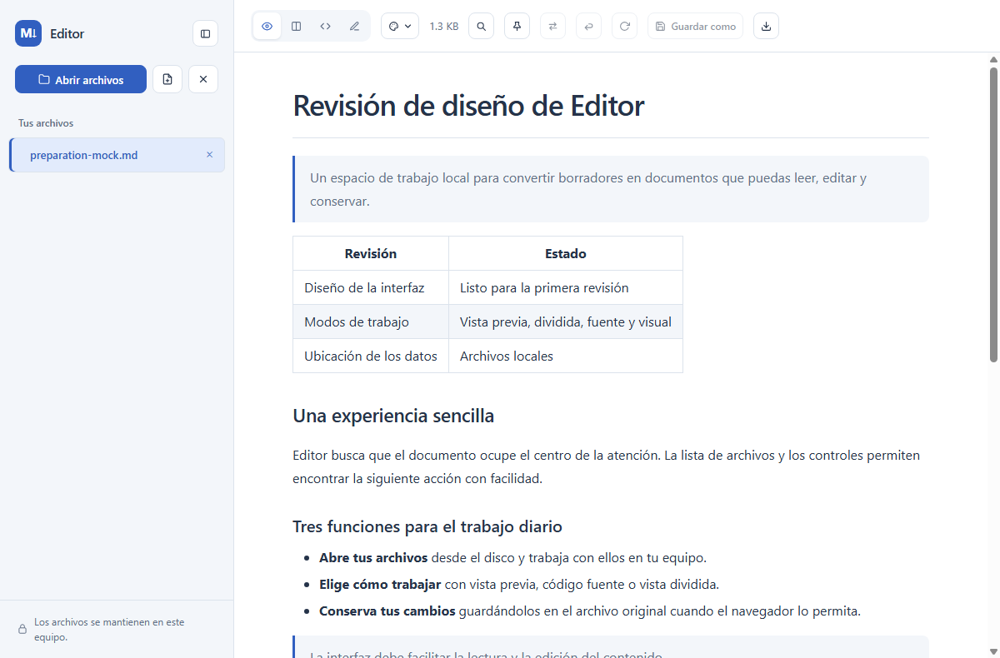
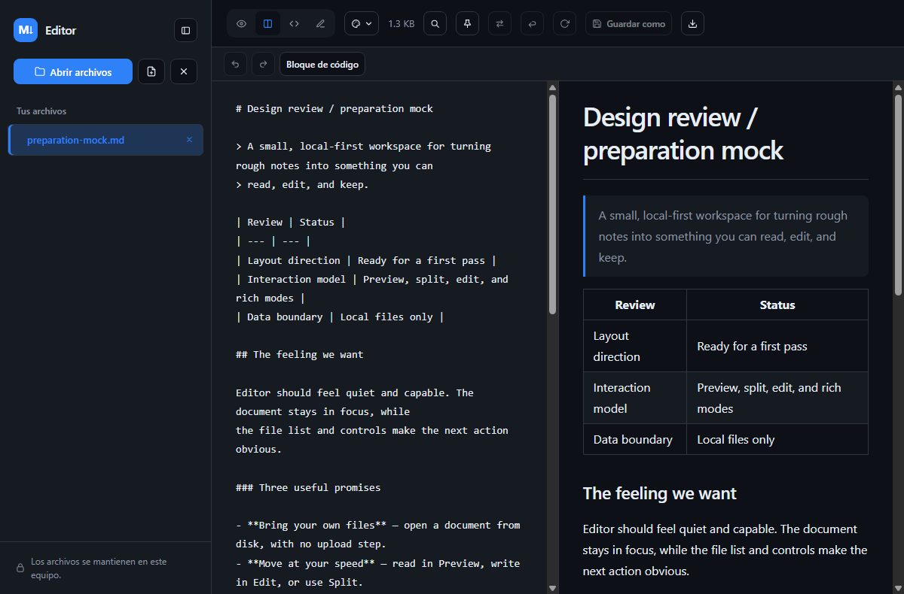

<p align="left"></p>

# Editor

Un editor de Markdown sin instalación, contenido en un único archivo. Abre
`index.html` en cualquier navegador y arrastra tus archivos `.md` para leerlos o
editarlos, con formato al estilo de GitHub, tema oscuro, resaltado de sintaxis y tablas.

Editor está basado en una bifurcación del proyecto
[ibmua/markdown-viewer-html](https://github.com/ibmua/markdown-viewer-html).

**Funciona sin compilación, servidor ni conexión, y los documentos permanecen en tu equipo.**
Todas las dependencias están incluidas en `index.html`, que puedes abrir directamente.

## Capturas de pantalla

Las dos capturas muestran el documento de ejemplo `preparation-mock.md` abierto en
Chrome desde el archivo local `index.html`.

**Tema claro · Vista previa**



**Tema oscuro · Vista dividida**



## Funciones

- **Arrastrar y soltar** uno o varios archivos `.md` sobre la página.
- **Abrir archivos** mediante el selector del sistema.
- **Modos de edición** con vista previa, vista dividida, código fuente y edición visual.
  La vista dividida actualiza la vista previa y sincroniza el desplazamiento entre paneles.
- **Deshacer y rehacer** desde la barra de edición, con un historial independiente por archivo.
- **Edición visual** del documento renderizado, con controles para títulos, negrita,
  cursiva, enlaces, listas, citas y código.
- **Guardar en el archivo original** en navegadores Chromium mediante la API de acceso al sistema de archivos.
- **Recargar desde el disco** para incorporar los cambios realizados con otro editor
  cuando el archivo se abrió con acceso al original.
- **Descargar una copia** del documento y recibir avisos cuando haya cambios pendientes.
- **Pegar Markdown** con <kbd>⌘V</kbd> o <kbd>Ctrl</kbd>+<kbd>V</kbd>, fuera del área de edición,
  para abrirlo como un archivo nuevo.
- **Varios archivos abiertos** en una barra lateral que permite cambiar entre ellos y
  cerrarlos individualmente. Un punto amarillo identifica los que tienen cambios pendientes.
- **Nuevo archivo** para empezar un documento desde cero.
- Markdown compatible con GitHub, incluidas tablas, listas de tareas, bloques de código y notas al pie.
- **Marcar línea** para volver a ella desde cualquier lugar y, además, retornar a la línea original.
- **Intercambio** entre los dos archivos usados por último para ir de uno a otro rápidamente.
- **Configuración** permite elegir el tema claro, oscuro o automático y previsualizar
  los estilos de highlight.js disponibles para cada tema. El editor recuerda un estilo por tema.
- Los documentos nuevos se guardan como temporarios en el almacenamiento local del
  navegador o de la aplicación de escritorio. Se recuperan al reabrir el Editor.
  La actualización automática del temporario se puede desactivar en Configuración.
  Guardar en una ruta local elimina el temporario. Descargar una copia lo conserva.
- Saneamiento del HTML con DOMPurify antes de mostrarlo.

## Uso

1. Descarga o clona este repositorio.
2. Abre `index.html` con un doble clic.

También puedes alojarlo en GitHub Pages configurando la publicación desde la raíz de `main`.

### Editor de escritorio para Windows

La versión Go abre el mismo `index.html` en una ventana nativa con WebView2. El
HTML está incluido en el ejecutable y la edición funciona sin conexión. Para
compilarla en Windows necesitas Go 1.22 o posterior. Para ejecutarla necesitas
[Microsoft Edge WebView2 Runtime](https://developer.microsoft.com/microsoft-edge/webview2/).

```powershell
go build -tags production -ldflags '-H=windowsgui' -o build/Editor.exe .
```

Copia `Editor.exe` a la ubicación donde lo quieras conservar. En el
Explorador, haz clic derecho en un `.md` y elige **Abrir con → Elegir otra
aplicación → Elegir una aplicación en el equipo**. Selecciona el ejecutable y
elige **Siempre** para usarlo como predeterminado. También puedes pasarle
archivos por línea de comandos, entre comillas si la ruta contiene espacios.

```powershell
.\build\Editor.exe "C:\Documentos\Mi archivo.md"
.\build\Editor.exe "xx\*.md"
```

La línea de comandos admite varios archivos o patrones. Usa `*` y `?` en el
nombre de archivo para abrir coincidencias de una carpeta.

Los archivos de texto UTF-8 recibidos al iniciar se abren en vista dividida.
**Ctrl+S** guarda en la ruta original o abre **Guardar como** para un documento
nuevo. **Recargar** vuelve a leer el disco. Al cerrar la ventana con cambios
pendientes, el editor pide confirmación.

### Carga desde una URL e integración

Cuando se sirve mediante HTTP, `index.html?fetch=<url>&name=<nombre>` descarga el
contenido de la URL y lo abre como una pestaña. El parámetro `fetch` puede
repetirse. Las direcciones deben tener el mismo origen o permitir el acceso mediante CORS.

Project City utiliza esta integración. Su servidor en `http://127.0.0.1:8129/`
expone el editor en `/mdview` y le proporciona archivos del proyecto, incluidos
archivos leídos desde TR mediante SSH.

## Atajos de teclado

| Atajo | Acción |
| :--- | :--- |
| <kbd>⌘</kbd>+<kbd>O</kbd> / <kbd>Ctrl</kbd>+<kbd>O</kbd> | Abrir archivos |
| <kbd>⌘</kbd>+<kbd>W</kbd> / <kbd>Ctrl</kbd>+<kbd>W</kbd> | Cerrar el archivo activo |
| <kbd>⌘</kbd>+<kbd>S</kbd> / <kbd>Ctrl</kbd>+<kbd>S</kbd> | Guardar en el archivo original o abrir Guardar como cuando esté disponible |
| <kbd>⌘</kbd>+<kbd>E</kbd> / <kbd>Ctrl</kbd>+<kbd>E</kbd> | Cambiar el modo de edición |
| <kbd>⌘</kbd>+<kbd>Z</kbd> / <kbd>Ctrl</kbd>+<kbd>Z</kbd> | Deshacer |
| <kbd>⌘</kbd>+<kbd>Shift</kbd>+<kbd>Z</kbd> / <kbd>Ctrl</kbd>+<kbd>Y</kbd> | Rehacer |
| <kbd>⌘</kbd>+<kbd>K</kbd> / <kbd>Ctrl</kbd>+<kbd>K</kbd> | Insertar un enlace en el modo visual |
| <kbd>⌘</kbd>+<kbd>V</kbd> / <kbd>Ctrl</kbd>+<kbd>V</kbd> | Pegar Markdown como un archivo nuevo |

## Guardar los cambios

JavaScript en el navegador necesita autorización para escribir en el disco.

- En **Chrome, Edge, Arc, Brave, Opera** y otros navegadores Chromium compatibles
  con la API de acceso al sistema de archivos, **Abrir archivos** conserva una
  referencia al original. **Guardar** escribe los cambios en ese archivo. El
  primer guardado puede solicitar permiso de escritura. Algunos navegadores
  también conservan esta referencia al arrastrar archivos.
- Cuando falta una referencia con permiso de escritura, los navegadores
  compatibles ofrecen **Guardar como**. En los demás, incluido Safari,
  **Descargar copia** exporta el documento con el nombre sugerido.

Una barra amarilla avisa cuando hay cambios pendientes. El navegador también
muestra una advertencia si intentas cerrar la pestaña con modificaciones sin guardar.

## Recargar desde el disco

**Recargar** vuelve a leer el archivo activo sin seleccionarlo de nuevo. Esta
función requiere una referencia `FileSystemFileHandle`, que los navegadores
Chromium proporcionan al usar **Abrir archivos** y, en algunos casos, al arrastrarlos.

Los archivos abiertos mediante un selector básico, el portapapeles o un navegador
sin esta API son copias del contenido en el momento de abrirlo. El botón de
recarga aparece deshabilitado para esas pestañas. Si el archivo activo tiene
cambios pendientes, Editor pide confirmación antes de sustituirlos por la versión del disco.

## Edición visual

El modo **Visual** permite editar el documento renderizado y convierte el resultado
a Markdown tras cada cambio. Admite títulos, párrafos, énfasis, enlaces, listas,
citas, bloques de código, tablas, imágenes, separadores y casillas de tareas.

La conversión entre Markdown y HTML editable puede normalizar espacios o modificar
el formato del código fuente. Usa **Fuente** cuando necesites conservar su disposición exacta.

## Dependencias incluidas

Todas las dependencias de ejecución están integradas en `index.html`. El editor
funciona sin descargar bibliotecas de la red, incluso desde una memoria USB o sin conexión.

- Conversión de Markdown a HTML con licencia MIT. [marked](https://github.com/markedjs/marked)
- Saneamiento del HTML con licencias Apache-2.0 y MPL-2.0. [DOMPurify](https://github.com/cure53/DOMPurify)
- Resaltado de sintaxis con licencia BSD-3. [highlight.js](https://github.com/highlightjs/highlight.js)
- Icono del navegador incluido como una URI de datos SVG.

Para actualizar una dependencia, descarga su versión minificada y sustituye el
contenido del bloque `<script>` correspondiente.

## Licencia

Este proyecto se distribuye con licencia MIT. Consulta [LICENSE](LICENSE).

## Estructura y diseño del proyecto

`index.html` es la aplicación principal y autosuficiente. Sus primeros bloques de
código y estilos contienen las dependencias marked, DOMPurify y highlight.js.
El último bloque de estilos de la aplicación define la paleta, la distribución
y las reglas de adaptación a distintos tamaños de pantalla. El cuerpo contiene
la barra lateral, los controles de modo y las superficies de edición.

El último bloque de JavaScript gestiona los archivos en memoria, las referencias
a archivos locales, el renderizado, la conversión entre edición visual y código
fuente, el guardado y los atajos. La plantilla `welcomeHTML` y su controlador de
clics reutilizan las acciones de abrir y crear archivos. La aplicación funciona
sin compilación ni fuentes externas.

Los valores de diseño se definen mediante propiedades CSS como `--bg`, `--fg`,
`--accent`, `--reading-width` y `--ui-radius`. El tema automático sigue la
preferencia del sistema. Por debajo de 560 píxeles, la barra lateral se convierte
en una lista superior compacta y la vista dividida coloca sus paneles verticalmente.

`icon.png` es la imagen de 256 × 256 píxeles extraída de los recursos del ejecutable
`Editor.exe` y utilizada al inicio de este README. `icon.svg` conserva la versión
vectorial del icono del navegador, que también está integrado en `index.html`.
Project City sirve el mismo HTML en su ruta `/mdview`.

`main_windows.go` integra el HTML en una ventana de Wails con WebView2.
`files_windows.go` adapta las rutas de inicio y los diálogos de Windows a los mismos
flujos de apertura, guardado y recarga. Los recursos `editor_windows_*.syso`
proporcionan el nombre y el icono de Windows al ejecutable.

El 21 de septiembre de 2026 se ajustaron el espacio de trabajo azul, la selección
de archivos, la tipografía, las acciones de bienvenida y la distribución móvil.
La comprobación original se realizó en Chrome sin interfaz sobre la URL del
archivo local, con documentos nuevos, edición del código fuente, los cuatro modos,
temas claro y oscuro y una pantalla de 390 píxeles de ancho.

Ese mismo día se añadió `preparation-mock.md` como documento de prueba visual
para títulos, tablas, listas, bloques de código y casillas de tareas.
